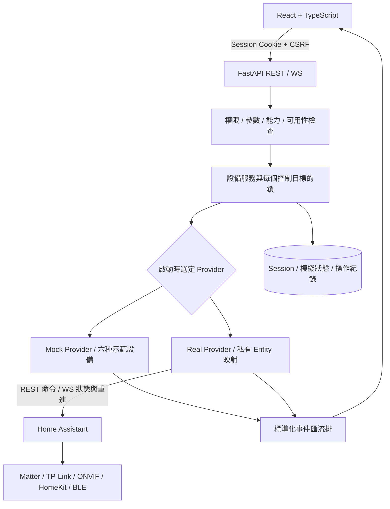

# 系統架構與技術決策

日期：2026-10-11。此文件描述已實作的本機 MVP；實機驗證屬 Phase 3。使用者已同意先在目前電腦製作測試版，之後移植樹莓派。

## 資料流

採用 HA 作為整合層，避免自有前端依賴品牌協定或持有品牌秘密。HTTPX 負責受控 HA service 呼叫；websockets 負責授權、先訂閱再讀快照、事件順序、斷線重連。前端使用 TanStack Query，WS 事件使資料查詢失效更新，不高頻輪詢全部裝置。

## 模組邊界

- `api`：驗證請求、Session／CSRF、REST 回應與瀏覽器 WS。
- `core`：環境設定、秘密欄位、錯誤格式與權限。缺少安全秘密或不完整 Real 設定時拒絕啟動。
- `models`：標準設備、動態能力、動作參數，以及 SQLAlchemy 表格。
- `services/devices.py`：檢查能力、目標、範圍、可用性及狀態新鮮度；串行化同一設備目標操作，記錄成功／失敗。
- `integrations`：Mock 與 Real 共享 provider 介面；不能因 Real 失敗自動切回 Mock 偽裝成功。
- `repository`：SQLite Session、模擬可操作設備狀態、操作紀錄。Room 目前由設備衍生；四個情境為 Mock 常數。EntityMapping 預留表格，實際白名單來自私有 JSON，不宣稱已有管理介面。
- React 元件依 capability 呈現；不支援的能力沒有按鈕。前後端各自驗證，後端才是權限與控制的最終依據。

## 狀態與確認

`online` 是三態：true／false／null。`available` 表示目前可用，`stale` 表示整合尚未同步，`state_confidence` 區分 reported／inferred／unknown／simulated。文件確認與實機 verified 分開。

Real 只發布後端選定的狀態、亮度、色溫、溫度、濕度、電量及全機功率欄位，丟棄 HA 原始 attributes，避免 camera URL／Token 洩露。單一 Entity 格式異常降為 unavailable；非有限數值不輸出。推定狀態不升級為設備回報，且不開放寫入。

MVP 動作採同步 HTTP 200 confirmed，並非早期草案的 202 工作佇列。Real 呼叫 service 之後，等待該 Entity 更新版本且達成目標；10 秒仍無確認回傳 504。命令被接受不代表完成。已達目標時再次命令也可能因沒有新事件而待確認；沒有盲目重試或狀態樂觀更新。HTTP 請求逾時不代表電器未執行。

WS 斷線立即清除 Real 快取；重新訂閱、快照同步後才恢復可用。穩態由 ping/pong 偵測連線，不把沒有設備事件視為斷線。事件佇列容量有限，滿時發送 resync_required，瀏覽器重新查詢。部署為單一後端 worker，不能直接水平擴充記憶體事件匯流排。

## 安全設計

隨機 admin 密碼、Session secret 只存忽略的 `.env`；8 小時 HttpOnly／SameSite Strict Cookie，Session 摘要存 SQLite。寫入要求允許的 Origin（瀏覽器）與 CSRF，設備控制另需 admin；viewer 可讀取及登出。登入限制每 IP 每分鐘 10 次。WS 檢查 Origin、Session 與持續有效性。後端只允許映射的 light／switch，亮度和色溫只允許 light；不提供任意 HA service 代理。

API 統一錯誤訊息不回傳原始例外／密碼；日誌與資料檔案不提交。C260 尚無影像出口。預設 localhost，沒有公開網路存取設定；正式 TLS 入口設定後須啟用 Secure Cookie。這是自用測試版，尚無密碼變更 UI、多使用者管理、完整稽核／資料保留政策或資料庫 migration。

## 部署決策

Windows 原生開發與正式部署分離。HA OS 作常駐設備層；本平台可使用獨立 Linux／樹莓派容器。提供 Python 3.12、Node 24 建置及 Nginx 同源代理，但容器和 arm64 尚待實測。SQLite named volume 保存資料，切換模式後操作紀錄以 mode 分隔。自動化優先交給 HA，避免建立第二套互相衝突的規則引擎。
## Windows 藍牙直連例外（2026-10-13）

香氛機經實機驗證後，由 RealProvider 合併可選的 BleDiffuser。前端仍只呼叫統一 API；後端 BLE 工作階段負責加密登入、屬性封包、寫入確認及退避重連。HA 裝置維持原有路徑。BLE 狀態不依賴 HA 是否在線；停用私有設定路徑時不載入 Bleak。

控制白名單僅包含已驗證的六項功能。此整合尚未將設備發布回 HA，因此目前不宣稱 HA 自動化能控制香氛機。定時後續應以 HA 作為單一排程來源，避免另外建立互相衝突的規則引擎。
